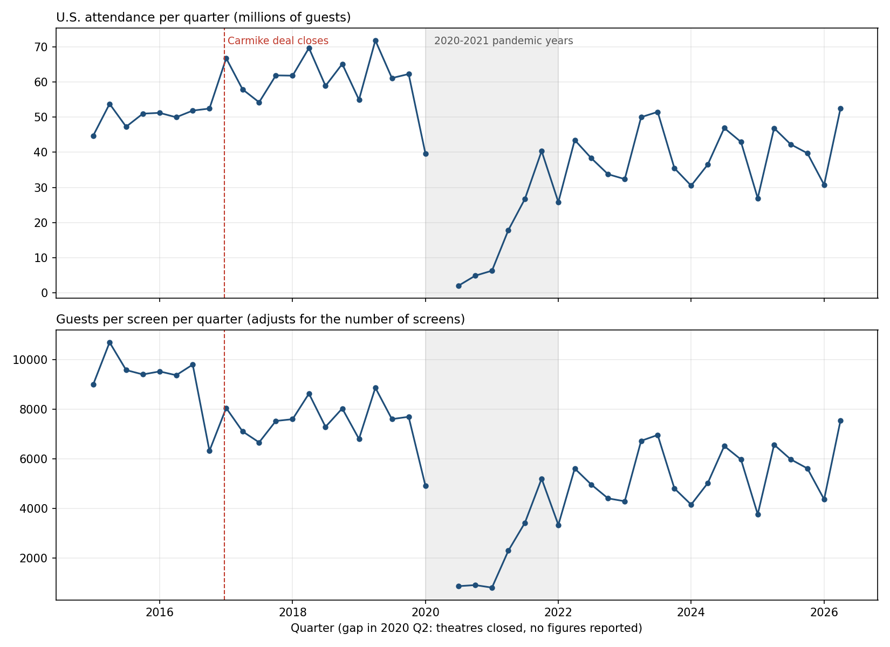
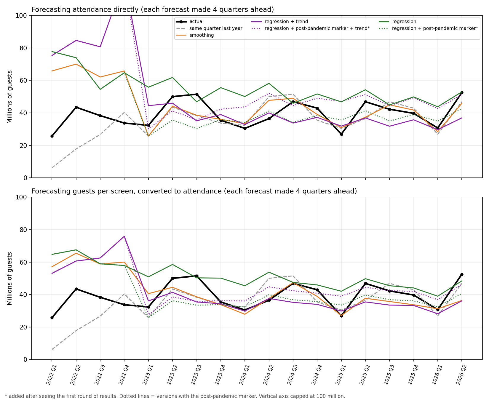
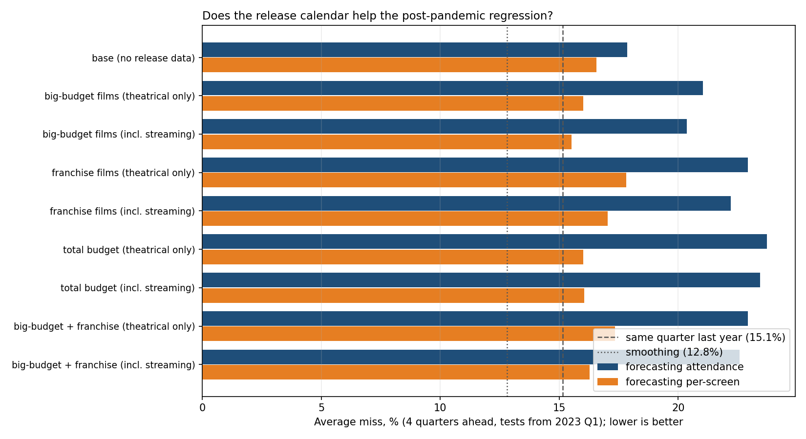
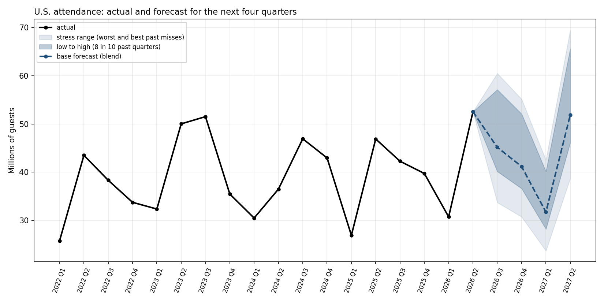
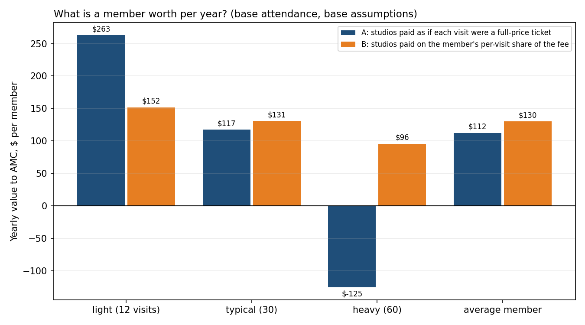
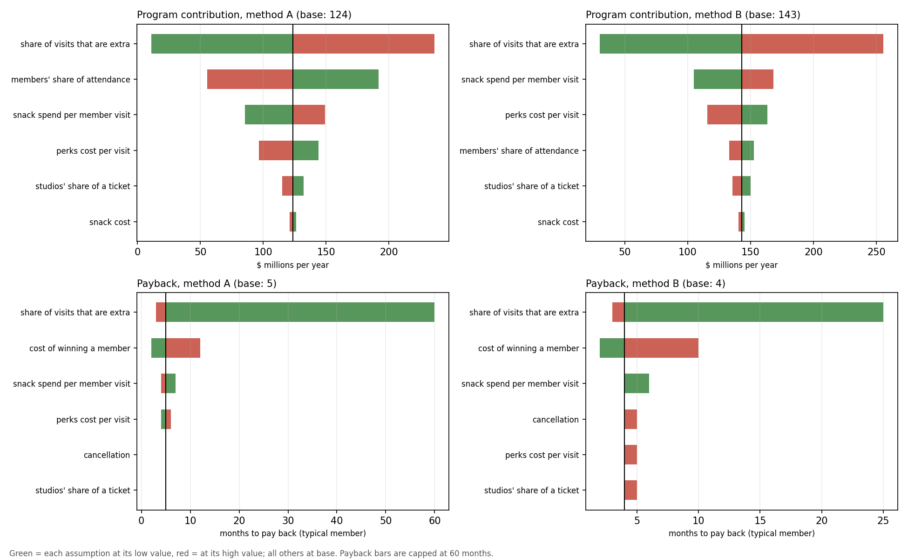
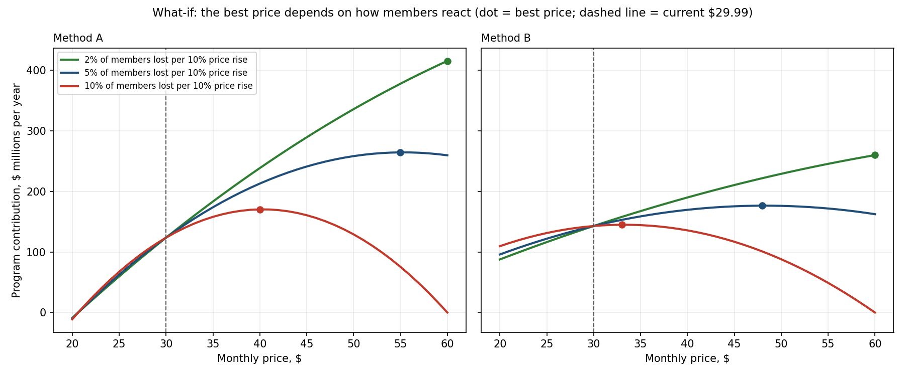

# AMC Attendance Forecast and Subscription Pricing Model

**How many people will go to AMC theatres over the next year, and what does that mean for a movie subscription like A-List?**

An end-to-end analysis in Python: a quarterly dataset built from AMC's SEC filings, a tested attendance forecast with scenarios, and an illustrative subscription-economics model.

> Independent project using publicly reported figures. Not affiliated with or endorsed by AMC Entertainment. This product uses the TMDB API but is not endorsed or certified by TMDB.

## Summary of findings

**Forecasting**
1. A simple blend (the average of a seasonal smoothing model and "same quarter last year") was the steadiest forecast: **17.1% average miss across all 18 tests** and 13.9% from 2023 onward, four quarters ahead.
2. **No model clearly beat the simple baselines.** From 2023, seasonal smoothing was best (12.8%), but the gaps between the top three were small for 14 tests.
3. **The release calendar did not help.** Adding counts of big-budget and franchise films (from the TMDB data of my [movie profitability project](https://github.com/julixlyz08/movie_profitability_analysis)) made forecasts slightly worse once post-pandemic data was available.
4. The forecast for **2026 Q3 to 2027 Q2 is 169.9 million U.S. guests**, with an 8-in-10 range of **151 to 215 million** and a stress range of **127 to 228 million**.

**Subscription model (illustrative, assumption-driven)**
5. A typical member is worth about **$117 to $131 a year** to AMC and pays back the cost of winning them in **4 to 5 months**, under the base assumptions.
6. **The share of member visits that are "extra"** (would not have happened without the subscription) dominates everything: moving it from 25% to 75% moves the program from about $11M to $236M a year (method A).
7. The **July 2026 price increase** ($27.99 to $29.99) pays unless AMC loses more than roughly **7% to 21% of its members**, depending on who leaves and how studios are paid. The assumed price response implies a loss of 1.4% to 7.1%.
8. The **"best price" cannot be identified** with public data. The model keeps rewarding higher prices unless members are very price-sensitive.

## Questions

1. How well can U.S. attendance be forecast one year ahead, and does knowing the film slate help?
2. What range of attendance should a planner prepare for?
3. Is a subscription like A-List profitable, which members drive that, and does a price increase pay?

## Data

| Source | What | Where |
|---|---|---|
| AMC quarterly reports (10-Q) and annual reports (10-K), "U.S. Markets" segment | Attendance, admissions revenue, food and beverage revenue, theatres, screens: 46 quarters, 2015 Q1 to 2026 Q2 | `amc_quarterly.csv` |
| TMDB API, via my movie profitability project | Release date, budget, and franchise status of 5,971 films (2000 to 2026): the movie project's dataset plus a re-pull of 2026 releases | `movies_clean.csv` |
| News coverage of AMC earnings and A-List announcements | Member counts, A-List price | `assumptions.csv` (with sources) |

Data notes:
- **Fourth quarters** are not reported on their own in the 10-K, so each Q4 is derived as the full-year figure minus Q1 to Q3. Theatres and screens are year-end counts.
- **2020 Q2** is left as "-", as AMC reported it (theatres were closed).
- **Carmike acquisition:** it closed on December 21, 2016, which makes U.S. theatres jump from 388 to 660 and attendance rise in 2017. The `carmike_period` column (`before`, `closing_quarter`, `after`) and notes mark this.
- Average ticket price and food and beverage spend per guest are **calculated** as revenue divided by attendance, rounded to the cent.
- Figures were checked against the nine-month totals in the third-quarter reports. Numbers in the CSV are rounded to two decimals.



## Part 1: Attendance forecast

**Test design.** For each quarter from 2022 Q1 to 2026 Q2 (18 tests), the models see only the data available four quarters earlier and predict that quarter. "Average miss" is the average of |forecast minus actual| as a share of actual.

**Models.**
- *Same quarter last year*
- *Seasonal smoothing* (ETS), with the eight pandemic quarters removed and the series joined up. Eight quarters is exactly two years, so the seasons stay aligned
- *Regression on logs*: quarter of the year, a pandemic marker (2020 to 2021), and a Carmike marker (0 before, 0.12 for 2016 Q4, 1 after)
- *Regression with a post-pandemic marker*\*, with and without a time trend
- *Regression plus release calendar*: counts of films with budgets of $100M or more, franchise films, and total budget, with and without the streaming-first films
- Each regression family was run forecasting attendance directly and forecasting guests per screen (converted back using the last known screen count)
- *Blend*: the average of seasonal smoothing and same quarter last year

\* **Added after seeing the first results**, because the original regression kept over-predicting once attendance settled below 2019 levels. Both versions are reported.

| Model | Average miss, all 18 tests | Average miss, from 2023 Q1 |
|---|---|---|
| Same quarter last year | 22.0% | 15.1% |
| Seasonal smoothing | 30.7% | 12.8% |
| **Blend (chosen)** | **17.1%** | 13.9% |
| Regression + post-pandemic marker\* | 36.4% | 17.9% |
| Regression + big-budget films | 33.7% | 21.0% |
| Original regression | 48.8% | 33.8% |

The 2022 tests are poor for every model: they forecast from pre-pandemic data while attendance was about half of 2019. The "from 2023" column is the better guide to current accuracy.




**Forecast and scenarios (millions of U.S. guests).** The low and high come from the 10th and 90th percentile of past misses of the blend (-11.1% and +26.5%); the stress cases are the worst and best misses (-25.4% and +34.0%).

| Quarter | Stress low | Low | Base | High | Stress high |
|---|---|---|---|---|---|
| 2026 Q3 | 33.7 | 40.2 | 45.2 | 57.1 | 60.5 |
| 2026 Q4 | 30.7 | 36.6 | 41.2 | 52.1 | 55.2 |
| 2027 Q1 | 23.7 | 28.2 | 31.7 | 40.1 | 42.5 |
| 2027 Q2 | 38.7 | 46.1 | 51.9 | 65.6 | 69.5 |
| **Full year** | **126.8** | **151.1** | **169.9** | **214.9** | **227.6** |

The 2027 Q2 forecast partly repeats 2026 Q2, the strongest quarter since the pandemic, so it assumes another big quarter.



## Part 2: Subscription model

An illustrative model of an A-List style subscription ($29.99 a month, about 1.1 million members). For each of three member types (light: 12 visits a year, typical: 30, heavy: 60), it compares AMC's profit **with** the subscription (fees, minus film costs and perks, plus snack profit) to its profit **without** it (the visits the person would have made anyway, at full price).

Two ways of paying studios on member visits are always shown:
- **Method A:** as if each member visit were a full-price ticket
- **Method B:** on the member's per-visit share of the fee

All assumptions, with low, base, and high values and their basis, are in `assumptions.csv`. Where possible they are anchored on AMC's reported figures (ticket price $12.70, snack spend $8.95, studios' share of tickets 54%, snack cost 17%, members about 20% of U.S. attendance). The share of extra visits, the cost of winning a member, cancellation rates, and price response are assumed, because no public data exists.

| Base case | Method A | Method B |
|---|---|---|
| Light member, value per year | $263 | $152 |
| Typical member | $117 | $131 |
| Heavy member | -$125 | $96 |
| Whole program, per year | $124M | $143M |
| Payback, typical member ($40 to win) | 5 months | 4 months |

- **Under method A, the program earns less in strong attendance years** ($193M in the stress-low scenario, $31M in stress-high), because the fee is fixed while members visit more. Under method B it is flatter ($153M to $130M).
- **July 2026 price increase:** AMC could lose about 21% (A) or 8.5% (B) of members if everyone leaves equally, or about 9% (A) or 7% (B) if only the most profitable (light) members leave, before the increase stops paying.
- **Best-price what-if:** at the base price response, the model's best price is $55 (A) or $48 (B), far above any price AMC has charged. This shows the assumption is too forgiving to find a sensible optimum. It is not a recommendation.





## Related project

The release-calendar data comes from my [movie profitability analysis](https://github.com/julixlyz08/movie_profitability_analysis), which collects and cleans TMDB data and publishes an interactive Tableau dashboard. This repository holds a copy of that dataset (with 2026 releases added), so it can be reproduced on its own.

## Limitations

- **The subscription model is illustrative.** It uses public figures and labeled assumptions, not AMC's internal accounting, and the extra-visit share, the cost of winning a member, cancellation rates, and price response are not public.
- It counts only film and snack costs (no labor, rent, or utilities), and perk costs are estimated.
- It uses one price, although A-List prices vary by state.
- Members' visits move in proportion to total attendance, and the extra-visit share is the same for all member types. Price changes do not change how often members visit.
- The forecast sample is small (46 quarters, 18 tests) and spans two structural breaks (the Carmike acquisition and the pandemic), so differences between the better models are within noise.
- The forecast ranges were measured four quarters ahead and applied to all four future quarters. The same percentage is applied to every quarter, so the scenarios assume the whole year runs high or low together.
- Release-calendar counts come from a sample of well-known TMDB films with reported budgets, count worldwide releases, and cannot distinguish a hit from a flop before release.
- Prices and members come from news coverage of AMC's announcements and earnings, and should be checked against AMC's own documents.

## How to run

```
pip install pandas numpy matplotlib statsmodels
python explore_quarterly.py      # charts of attendance over time
python forecast_attendance.py    # rolling 4-quarters-ahead tests (needs movies_clean.csv)
python compare_candidates.py     # scoreboard of the candidate forecasts
python forecast_next_year.py     # forecast and five scenarios for 2026 Q3 to 2027 Q2
python subscription_model.py     # the subscription model (reads assumptions.csv)
```

## Repository layout

```
amc_quarterly.csv   quarterly U.S. data from AMC filings
movies_clean.csv             release data from the movie profitability project (TMDB)
assumptions.csv              every assumption, with low / base / high and its basis
explore_quarterly.py, forecast_attendance.py, compare_candidates.py,
forecast_next_year.py, subscription_model.py
forecast_results.csv, candidate_scoreboard.csv, attendance_scenarios.csv   intermediate outputs
charts/                      all charts (created by the scripts)
results/                     the four subscription model result tables
```
